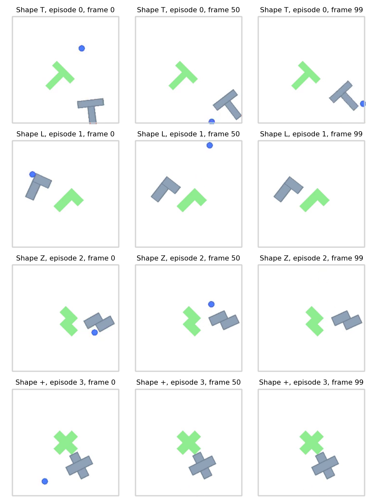
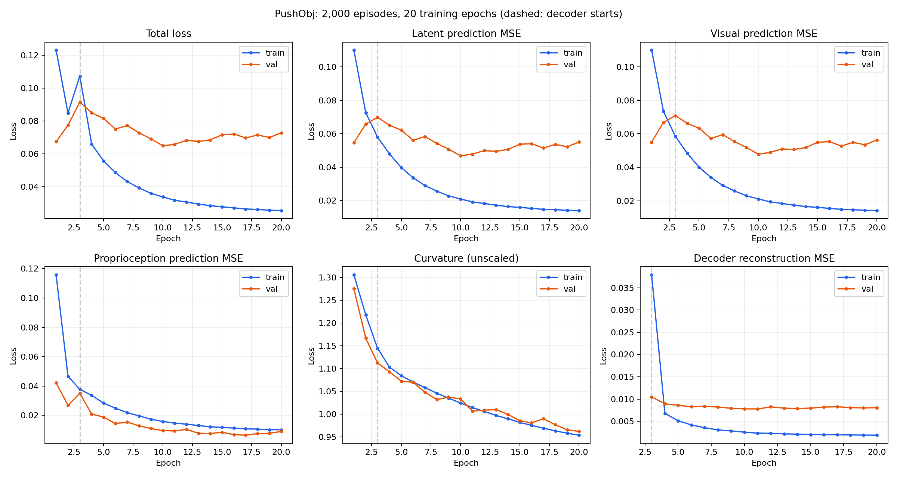

# PushObj 重新训练与评估报告

状态：已完成全部训练与评估。训练 20/20 轮，评估 14/14 组。

## 主要结论

本次20轮训练、350个目标×两种规划器的评估均已完成。最终冻结模型成功率为4.00%，AdaJEPA为9.14%，相差5.14个百分点。
同目标上的发布模型冻结基线为43.71%。本次在线适应提高了成功率，但新训练模型的整体规划能力仍明显落后于发布模型。
第20轮训练/验证总loss为0.02558642/0.07278752；潜在预测MSE为0.01413804/0.05509654。
验证潜在预测MSE在第10轮最低（0.04684202）；第20轮较最低值回升17.62%，而训练损失继续下降，表现出过拟合迹象。

### 数据分布检查及解释

在180,000个训练帧中，agent坐标超出[0,512]画布的比例为36.60%；所选200条已见形状发布评估轨迹中的对应比例为0.00%。
训练agent位置标准差约215px，所选发布评估轨迹约92–95px。现有相关随机游走采集没有保证操作点始终留在画布内，这是明确的数据质量和分布差异。
可能的影响是模型花费较多容量拟合边界外/不可见操作点的轨迹，降低对评估任务中有效推物体行为的覆盖。该解释是基于统计的推断，本次没有开展控制变量实验，不能认定是唯一原因。
下一步应优先约束采集边界、提高有效接触和目标相关运动覆盖；保持本次测试目标不参与调参。也可以先评估验证损失最佳的第10轮检查点。本报告中的正式成功率全部来自第20轮，未用第10轮替换结果。

## 实验范围与数据

从头训练 SmallResNet-GeM 世界模型。训练架构、优化器和学习率以本地发布的 pushobj_shape_shift/hydra.yaml 为参考。
这次使用本地仿真生成的数据；不声称严格复现论文的原始训练数据或论文分数。

| 数据 | 训练集 | 验证集 |
|---|---:|---:|
| 轨迹 | 1800 | 200 |
| 每条帧数 | 100 | 100 |
| 窗口数 | 145800 | 16200 |
| T/L/Z/+ 每种轨迹数 | 450 | 50 |
| 物体首尾位移 >5px | 74.78% | 74.50% |

2000 个视频均检查帧数并解码首帧、中间帧和末帧。轨迹张量全部有限，训练与验证集没有完全重复轨迹。
生成参数：seed=0、sigma=20px、rho=0.85、near_ratio=0.7、初始邻近半径=40px、动作存为像素位移、加载时除以100。
I、small_tee、square 未用于训练，是本次未见形状评估。原有500条数据目录保留；新目录按同一生成方法生成2000条数据，重新按90%/10%分区。



## 完整超参数

完整解析配置见 training_config.yaml；软件版本见 environment.txt。主要参数如下：

| 参数 | 数值 |
|---|---|
| 图像/特征 | 224×224；SmallResNetGeM；1×384 token；GeM p初值3（可学习） |
| 参数量 | 总计34,295,767；encoder 4,269,144；predictor 19,886,260；decoder 10,140,163；动作/状态编码器200 |
| Predictor | 6层，16 heads，dim_head=64，MLP=2048，dropout=0.1，embedding dropout=0 |
| 动作/自身状态编码 | 各10维；concat_dim=1；预测器输入维度404 |
| 时间 | frameskip=5，num_hist=3，num_pred=1 |
| 训练 | seed=0；batch=64；20 epochs；bf16；单卡RTX3090（GPU4） |
| Encoder优化器 | Adam，lr=1e-5，weight_decay=0 |
| Predictor优化器 | AdamW，lr=5e-4，weight_decay=0.01 |
| Action/Proprio优化器 | 共用AdamW，lr=5e-4，weight_decay=0.01 |
| Decoder优化器 | Adam，lr=3e-4，weight_decay=0；从第3轮开始 |
| 优化器公共设置 | betas=(0.9,0.999)，eps=1e-8；无训练学习率调度；无梯度裁剪 |
| 正则 | cos1e-2；stop_grad=true；VCReg关闭 |
| Decoder | VQVAE，channel=384，n_embed=2048，4残差块，res_channel=128，quantize=false |
| 数据处理 | 图像归一化至[-1,1]；沿用仓库固定动作/自身状态统计量 |
| 工程设置 | 8个数据加载worker；每轮保存；W&B离线；不计算可选LPIPS |

与发布配置的主要差异：训练由5轮扩展至20轮；采用2000条本地生成轨迹；worker从16改为8；关闭不参与损失的LPIPS指标。
归一化统计量为兼容发布评估保持不变。新数据的自身位置标准差约215px，明显大于原固定统计量约100px；这反映采集分布差异，是效果解释的重要限制。

## 损失及训练结果

总损失 = 潜在状态预测MSE + 0.01×曲率正则 +（第3轮起）解码器重建损失。
潜在预测MSE在384维视觉特征和10维自身状态特征上共同取均值，不是两个分项MSE的简单相加。
解码器输入特征停止梯度，因此重建损失只更新解码器。代码记录的 decoder_loss_pred 不加入总损失；本次保留原实现。
第3轮起总损失的定义增加了重建项，不能直接把第1轮与第20轮总损失的比例当作收敛幅度。
losses.csv 保存每轮全部指标；下表列出核心损失（曲率为未乘0.01的值）。



| Epoch | Train total | Val total | Train latent | Val latent | Val visual | Val proprio | Val curvature | Val recon | 秒/轮 |
|---:|---:|---:|---:|---:|---:|---:|---:|---:|---:|
| 1 | 0.123172 | 0.0674498 | 0.110112 | 0.0546948 | 0.0550219 | 0.0421325 | 1.27551 | — | 552.387 |
| 2 | 0.0848643 | 0.0774602 | 0.0726859 | 0.0657901 | 0.0668033 | 0.0268837 | 1.16701 | — | 546.335 |
| 3 | 0.10736 | 0.0915426 | 0.0579835 | 0.0699346 | 0.0708444 | 0.0350005 | 1.11242 | 0.0104838 | 1907.53 |
| 4 | 0.0659032 | 0.0849918 | 0.0480663 | 0.0651153 | 0.0662667 | 0.0209017 | 1.09321 | 0.00894453 | 1900.1 |
| 5 | 0.055782 | 0.0815621 | 0.039808 | 0.0622275 | 0.0633586 | 0.0187921 | 1.07272 | 0.0086074 | 1898.84 |
| 6 | 0.0486493 | 0.075128 | 0.0337319 | 0.0561495 | 0.0572379 | 0.0143544 | 1.07008 | 0.00827774 | 1901.59 |
| 7 | 0.0431878 | 0.0772696 | 0.0290346 | 0.0583795 | 0.0594988 | 0.0153954 | 1.04824 | 0.00840781 | 1896.3 |
| 8 | 0.0392884 | 0.072801 | 0.0257275 | 0.0542687 | 0.0553482 | 0.0128174 | 1.03234 | 0.00820887 | 1900.49 |
| 9 | 0.0360724 | 0.0691277 | 0.0228725 | 0.0508071 | 0.051843 | 0.0110304 | 1.0376 | 0.00794447 | 1896.2 |
| 10 | 0.0338415 | 0.0649909 | 0.0210184 | 0.046842 | 0.0478121 | 0.00959117 | 1.0336 | 0.0078129 | 1893.94 |
| 11 | 0.0318096 | 0.0657426 | 0.0193042 | 0.0478876 | 0.0488919 | 0.00932258 | 1.00707 | 0.00778436 | 1891.11 |
| 12 | 0.0307251 | 0.0683059 | 0.0183387 | 0.0499562 | 0.0509865 | 0.0103958 | 1.00897 | 0.00825994 | 1891.79 |
| 13 | 0.0294641 | 0.0676063 | 0.01729 | 0.0495317 | 0.0506191 | 0.00777624 | 1.01033 | 0.00797129 | 1895.04 |
| 14 | 0.028549 | 0.0685482 | 0.0165199 | 0.0506622 | 0.0517847 | 0.00755756 | 0.999843 | 0.00788758 | 1890.84 |
| 15 | 0.0278401 | 0.0715963 | 0.0159671 | 0.0537577 | 0.0549381 | 0.00843075 | 0.985786 | 0.00798081 | 1891.69 |
| 16 | 0.0271936 | 0.0721185 | 0.0154209 | 0.0541049 | 0.0553362 | 0.00682267 | 0.981324 | 0.0082003 | 1890.4 |
| 17 | 0.0265154 | 0.0697091 | 0.0148233 | 0.0515155 | 0.0526887 | 0.00646466 | 0.990119 | 0.00829241 | 1888.65 |
| 18 | 0.0262031 | 0.0715285 | 0.0146195 | 0.0536736 | 0.0548753 | 0.00752491 | 0.977071 | 0.00808421 | 1888.11 |
| 19 | 0.0257605 | 0.0699706 | 0.0142473 | 0.0522862 | 0.0534457 | 0.00776261 | 0.966064 | 0.00802375 | 1889.9 |
| 20 | 0.0255864 | 0.0727875 | 0.014138 | 0.0550965 | 0.0562968 | 0.00900495 | 0.962492 | 0.00806606 | 1888.65 |

目前最低验证潜在预测损失出现在第 10 轮：0.046842023。正式规划评估固定使用第20轮，不根据测试成功率挑选模型。
已记录训练和逐轮验证总耗时：9.778小时（不含保存、启动和规划评估）。

## 目标到达评估

采用发布的7种形状目标，每种随机抽取50例，seed=100；冻结模型和AdaJEPA使用完全相同的初始与目标状态。
GD规划：Adam，初始lr=0.1，100次优化，余弦学习率衰减；horizon=25环境步；每轮执行5环境步；最多20次MPC重规划；复用未执行动作。
目标函数：staged，alpha=1、base=2；起始观测1帧；无视觉扰动。
AdaJEPA：每轮1次梯度更新；Adam；predictor lr=5e-4，encoder lr=1e-5；recent5回放；更新预测器最后层及末端归一化、编码器projection；每例重置权重。
成功标准：agent和物体位置组成的4维向量与目标距离<20px，角度最短差<π/9。区间为Wilson 95%置信区间。

| Shape | 类别 | Planner | 成功/总数 | 成功率 | 95% CI | 平均状态距离 |
|---|---|---|---:|---:|---|---:|
| T | ID | frozen | 6/50 | 12.0% | 5.6%–23.8% | 206.6369 |
| T | ID | adajepa | 6/50 | 12.0% | 5.6%–23.8% | 188.3354 |
| L | ID | frozen | 3/50 | 6.0% | 2.1%–16.2% | 208.7339 |
| L | ID | adajepa | 6/50 | 12.0% | 5.6%–23.8% | 235.6410 |
| Z | ID | frozen | 0/50 | 0.0% | 0.0%–7.1% | 257.0894 |
| Z | ID | adajepa | 3/50 | 6.0% | 2.1%–16.2% | 289.3282 |
| + | ID | frozen | 1/50 | 2.0% | 0.4%–10.5% | 227.7194 |
| + | ID | adajepa | 5/50 | 10.0% | 4.3%–21.4% | 202.2995 |
| I | OOD | frozen | 1/50 | 2.0% | 0.4%–10.5% | 283.4246 |
| I | OOD | adajepa | 2/50 | 4.0% | 1.1%–13.5% | 230.5283 |
| small_tee | OOD | frozen | 3/50 | 6.0% | 2.1%–16.2% | 238.4835 |
| small_tee | OOD | adajepa | 7/50 | 14.0% | 7.0%–26.2% | 191.4912 |
| square | OOD | frozen | 0/50 | 0.0% | 0.0%–7.1% | 234.9034 |
| square | OOD | adajepa | 3/50 | 6.0% | 2.1%–16.2% | 191.4608 |

| 汇总 | Frozen | AdaJEPA | 差值 |
|---|---:|---:|---:|
| 已见形状 | 5.00% | 10.00% | +5.00个百分点 |
| 未见形状 | 2.67% | 8.00% | +5.33个百分点 |
| 全部 | 4.00% | 9.14% | +5.14个百分点 |

以上是单个训练随机种子、每形状50例的实测结果。没有多训练种子重复实验，不能据此声称复现论文结论或具有稳定统计优势。

### 发布模型的额外对照

以下使用发布检查点、冻结世界模型、相同50例目标及相同规划参数。用于区分重新训练效果和数据分布差异，不是论文表格分数。

| Shape | 发布模型 frozen | 本次训练 frozen | 本次训练 AdaJEPA |
|---|---:|---:|---:|
| T | 54.0% | 12.0% | 12.0% |
| L | 58.0% | 6.0% | 12.0% |
| Z | 46.0% | 0.0% | 6.0% |
| + | 52.0% | 2.0% | 10.0% |
| I | 24.0% | 2.0% | 4.0% |
| small_tee | 46.0% | 6.0% | 14.0% |
| square | 26.0% | 0.0% | 6.0% |

### 在线适应损失

| Shape | 更新次数 | 平均预测MSE | 中位数 | 最小 | 最大 |
|---|---:|---:|---:|---:|---:|
| T | 933 | 0.187386 | 0.103677 | 0.000865905 | 1.1962 |
| L | 948 | 0.181948 | 0.0834072 | 0.00100676 | 1.25137 |
| Z | 979 | 0.208054 | 0.121854 | 0.00120285 | 1.40399 |
| + | 957 | 0.205085 | 0.143224 | 0.000894434 | 1.20759 |
| I | 975 | 0.241682 | 0.165635 | 0.00104354 | 1.18795 |
| small_tee | 941 | 0.167509 | 0.0947255 | 0.00110496 | 1.03422 |
| square | 974 | 0.178839 | 0.096509 | 0.00102713 | 1.07569 |

adaptation_losses.csv 保存每例、每次MPC、每次微调的原始损失。此数值在优化更新前记录；每轮数据缓冲区会变化，不能将其首尾变化简单解释为固定数据集上的收敛。

## 修复与验证

- 恢复检查点时保留动作/自身状态编码器；保存、恢复共用优化器状态。
- epochs改为目标总轮数；保存单进程随机数状态；检查点采用临时文件加原子替换。
- 因果mask随模型设备迁移，并兼容旧检查点，支持CPU恢复检查。
- 静止轨迹的曲率正则返回0，避免空集合均值导致NaN；修复next1指标空切片。
- 本地JSONL保存逐轮全部指标；核心损失按样本数加权。
- 第3轮首次运行遇到显存不足；发现诊断用预测解码、重复图像编码保留了不参与损失的计算图，改为no_grad后连续完整batch64验证通过，并从第2轮检查点恢复。实际训练损失、batch和学习率不变。
- CPU回归：所有模型权重恢复一致；下一次更新的损失/权重与不中断训练精确一致；检查总轮数与静止轨迹梯度。
- GPU检查：batch64完成3轮训练，覆盖解码器启用；从第3轮恢复后只训练第4轮，四个优化器均恢复；训练检查点的AdaJEPA规划加载通过。
- 最终检查点确认为epoch20：encoder、predictor、动作/状态编码优化器各45,580次更新，decoder为41,022次更新；所有模型张量有限。
- 续训保证以单进程、轮次边界为范围；本次不启用轮中检查点。

## 文件与复现

模型目录：`/home/appuser/workspace/project/multimodal-test/adajepa/checkpoints/pushobj_2000_e20_seed0_20260923`。第20轮：`checkpoints/model_20.pth`；全部轮次均保留。
```bash
conda activate ts
cd /home/appuser/workspace/project/multimodal-test/adajepa
CUDA_VISIBLE_DEVICES=4 WANDB_MODE=offline OMP_NUM_THREADS=4 OPENBLAS_NUM_THREADS=1 MKL_NUM_THREADS=4 SDL_VIDEODRIVER=dummy python train.py --config-name train_pushobj
```
同一目录存在检查点时会续训；另开从头训练实验必须覆盖 hydra.run.dir 为新目录。
逐轮指标：losses.csv、模型目录metrics.jsonl；完整配置：training_config.yaml；数据检查：dataset_audit.json；逐例评估：各评估目录final_eval_results.npz；原始日志与源码差异一并保留。
参考：[Temporal Straightening训练说明](https://github.com/agentic-learning-ai-lab/temporal-straightening#training)；本地发布检查点hydra.yaml。
