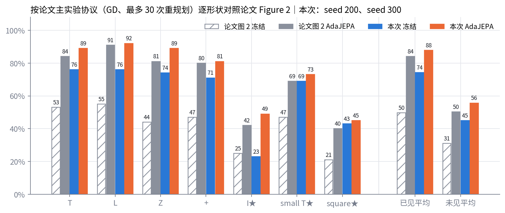
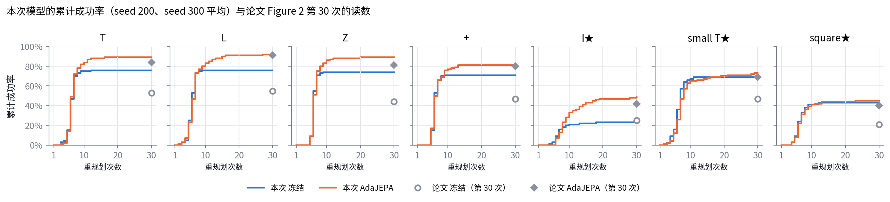
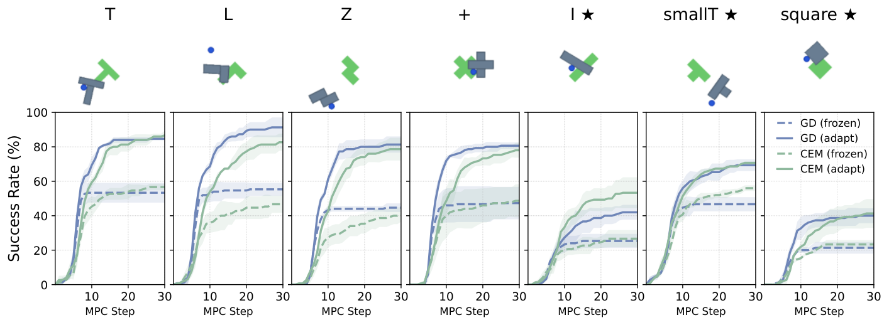
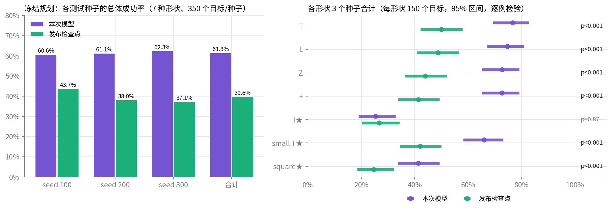
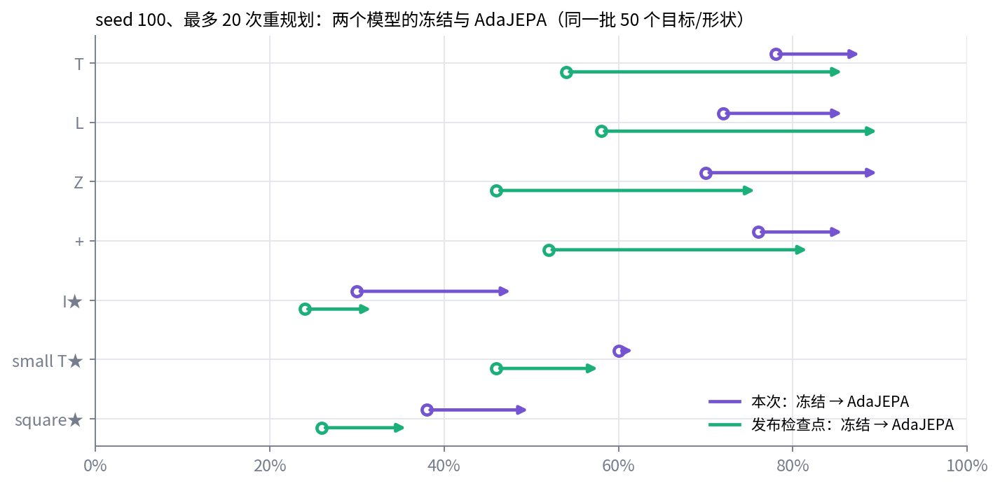
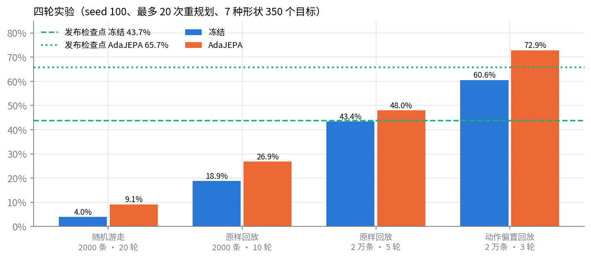
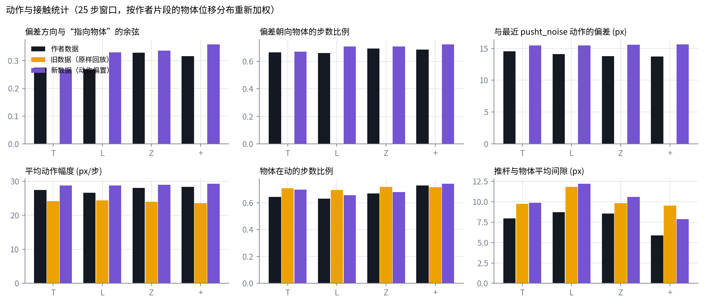
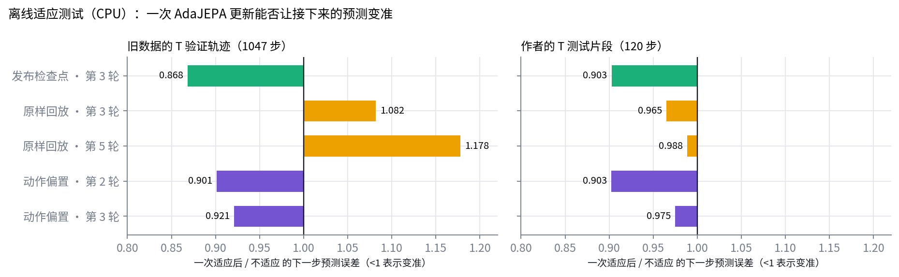
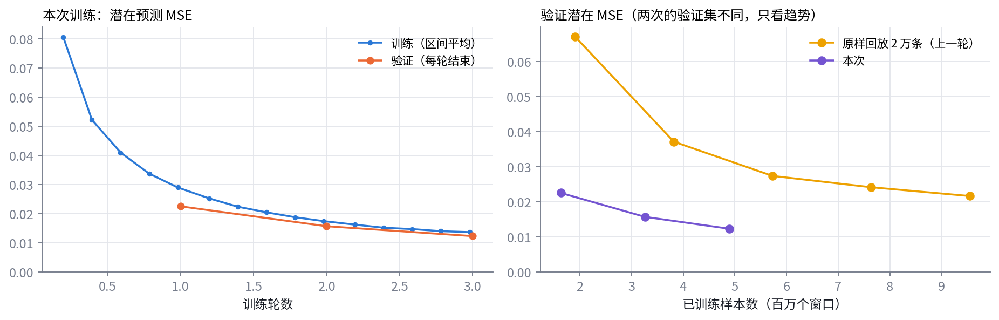

# AdaJEPA PushObj 复现：训练数据加入动作偏置

生成于 2026-09-30 09:44 UTC。模型 `checkpoints/pushobj_bias_16k_e3_seed0`（第 3 轮），数据 `data/pushobj_bias_16k`。交互版见同目录的 `report.html`（浏览器直接打开，不需要联网）。

## 1. 结论

- **按论文主实验协议（GD、最多 30 次重规划）对照 Figure 2**：AdaJEPA 已见形状 87.8%（论文约 84%），未见形状 55.7%（论文约 50%），7 / 7 种形状达到或超过论文。本次为 seed 200、seed 300，共 700 个目标；论文为 3 个测试种子平均，数值从图上读出，约 ±2 个百分点。
- **冻结规划稳定超过发布检查点**：3 个测试种子、1,050 个目标上 61.3% 对 39.6%（逐例 p<0.001），7 种形状中 6 种显著领先，只有 I 持平。
- **AdaJEPA 与发布检查点逐例对照（seed 100、20 次）**：已见 87.5% 对 83.5%（p=0.29，持平），未见 53.3% 对 42.0%（p=0.01）。
- **相对上一轮**（原样回放 2 万条、5 轮）：seed 100 上冻结 43.4% → 60.6%，AdaJEPA 48.0% → 72.9%。
- AdaJEPA 的增益（已见 +13.5、未见 +10.7 个百分点）小于论文（+34.2、+19.3），因为冻结起点高得多。

## 2. 本次改动（相对上一轮）

| 项目 | 上一轮 | 本次 |
|---|---|---|
| 动作 | 原样回放 pusht_noise 的动作 | 每一步加 9 px 指向物体重心的偏置和 σ=10 px 高斯噪声（按作者测试片段的动作统计标定），保存实际执行的动作 |
| 物体初始位置 | 新形状的重心对齐 T 的重心 | 放在源轨迹里 T 的原位 |
| 轨迹条数（训练 / 验证） | 18,000 / 2,000 | 16,000 / 4,000（论文每种形状 4,000 条训练） |
| 每条轨迹平均接触步数 | 43.6 | 60.6 |
| 训练轮数 | 5 | 3（与论文、发布检查点一致） |
| decoder | 不训练 | 第 3 轮起训练（只用于可视化，与发布检查点一致） |

不变：模型结构、训练超参数（论文表 3）、初始状态质量门槛和评估协议。训练用 4 张 RTX 3090，3.9 小时。

## 3. 结果

### 3.1 按论文主实验协议对照 Figure 2（GD，最多 30 次重规划）

| 形状 | 论文图 2 冻结 → AdaJEPA | seed 200 | seed 300 | 本次合计 | 只有 AdaJEPA / 只有冻结 |
|---|---|---|---|---|---|
| T | 53% → 84% | 80% → 90% | 72% → 88% | 76% → 89% | 16 / 3（p=0.004） |
| L | 55% → 91% | 78% → 92% | 74% → 92% | 76% → 92% | 18 / 2（p<0.001） |
| Z | 44% → 81% | 76% → 92% | 72% → 86% | 74% → 89% | 17 / 2（p<0.001） |
| + | 47% → 80% | 68% → 82% | 74% → 80% | 71% → 81% | 10 / 0（p=0.002） |
| I★ | 25% → 42% | 16% → 46% | 30% → 52% | 23% → 49% | 28 / 2（p<0.001） |
| small T★ | 47% → 69% | 64% → 72% | 74% → 74% | 69% → 73% | 13 / 9（p=0.52） |
| square★ | 21% → 40% | 46% → 50% | 40% → 40% | 43% → 45% | 7 / 5（p=0.77） |
| **已见平均** | 50% → 84% | 76% → 89% | 73% → 86% | **74.2% → 87.8%** | 61 / 7（p<0.001） |
| **未见平均** | 31% → 50% | 42% → 56% | 48% → 55% | **45.0% → 55.7%** | 48 / 16（p<0.001） |
| **全部** | 42% → 70% | 61% → 75% | 62% → 73% | **61.7% → 74.0%** | 109 / 23（p<0.001） |

冻结规划在第 20 次以后不再有新的成功；AdaJEPA 从第 20 次到第 30 次，已见 87.5% → 87.8%，未见 53.7% → 55.7%。

论文原图（arXiv:2606.32026 Figure 2 上排，CC BY 4.0）：

### 3.2 冻结规划：3 个测试种子，与发布检查点逐例对照（最多 20 次重规划）

| 形状 | seed 100：本次 / 发布（/50） | seed 200：本次 / 发布（/50） | seed 300：本次 / 发布（/50） | 合计 本次 | 合计 发布 | 只有本次 / 只有发布 |
|---|---|---|---|---|---|---|
| T | 39 / 27 | 40 / 22 | 36 / 26 | 76.7% | 50.0% | 53 / 13（p<0.001） |
| L | 36 / 29 | 39 / 23 | 37 / 21 | 74.7% | 48.7% | 50 / 11（p<0.001） |
| Z | 35 / 23 | 38 / 21 | 36 / 22 | 72.7% | 44.0% | 56 / 13（p<0.001） |
| + | 38 / 26 | 34 / 17 | 37 / 19 | 72.7% | 41.3% | 63 / 16（p<0.001） |
| I★ | 15 / 12 | 8 / 13 | 15 / 15 | 25.3% | 26.7% | 19 / 21（p=0.87） |
| small T★ | 30 / 23 | 32 / 20 | 37 / 20 | 66.0% | 42.0% | 49 / 13（p<0.001） |
| square★ | 19 / 13 | 23 / 17 | 20 / 7 | 41.3% | 24.7% | 37 / 12（p<0.001） |
| **已见** |  |  |  | **74.2%** | **46.0%** | 222 / 53（p<0.001） |
| **未见** |  |  |  | **44.2%** | **31.1%** | 105 / 46（p<0.001） |
| **全部** |  |  |  | **61.3%** | **39.6%** | 327 / 99（p<0.001） |

### 3.3 AdaJEPA：与发布检查点逐例对照（seed 100，最多 20 次重规划）

| 形状 | 发布检查点 冻结 → AdaJEPA | 本次 冻结 → AdaJEPA | AdaJEPA 只有本次 / 只有发布 |
|---|---|---|---|
| T | 54% → 86% | 78% → 88% | 5 / 4（p=1.00） |
| L | 58% → 90% | 72% → 86% | 5 / 7（p=0.77） |
| Z | 46% → 76% | 70% → 90% | 11 / 4（p=0.12） |
| + | 52% → 82% | 76% → 86% | 5 / 3（p=0.73） |
| I★ | 24% → 32% | 30% → 48% | 10 / 2（p=0.04） |
| small T★ | 46% → 58% | 60% → 62% | 9 / 7（p=0.80） |
| square★ | 26% → 36% | 38% → 50% | 10 / 3（p=0.09） |
| **已见** | 52.5% → 83.5% | 74.0% → 87.5% | 26 / 18（p=0.29） |
| **未见** | 32.0% → 42.0% | 42.7% → 53.3% | 29 / 12（p=0.01） |
| **全部** | 43.7% → 65.7% | 60.6% → 72.9% | 55 / 30（p=0.009） |

发布检查点在同一评估管线下已见形状 52.5% → 83.5%，与论文一致，说明评估本身没有问题。

### 3.4 四轮实验

## 4. 可能的提升原因

**AdaJEPA 重新起作用：直接原因是训练数据加入了动作偏置（证据较充分）**

- 上一轮 AdaJEPA 在 T 上只提升 +2.0 个百分点，发布检查点在同一批目标上提升 +32.0。
- 离线测试（CPU）：上一轮模型做一次适应更新后，对接下来一帧的预测误差变成原来的 1.18 倍（越适应越差）；换成带偏置的数据后为 0.92 倍，发布检查点 0.87 倍。
- 训练超参数、推理协议和代码改动都已逐项排除，两轮之间唯一的实质变化是训练数据。
- 可能的机制（推测）：规划器执行的动作几乎都是有目的地推物体，而原样回放的动作与新形状的几何无关，很多步在空中移动或擦边。适应时刚执行的片段落在训练分布之外，一步更新拟合了这段片段，却推广不到接下来的帧；加入偏置后训练数据里朝物体推的动作与规划时接近。

**冻结规划比发布检查点高约 22 个百分点：原因待验证**

- 差距稳定：3 个测试种子、1,050 个目标上 61.3% 对 39.6%，不是抽到容易目标的偶然。
- 已排除：初始状态质量门槛（上一轮同样有，冻结只有 43.4%，与发布检查点持平）；训练轮数。
- 候选一：动作偏置和噪声让每条轨迹的接触步数从 43.6 增加到 60.6，动作也更多样。
- 候选二：偏置按作者测试片段的统计量标定，训练分布可能比作者自己的训练数据更贴近测试目标；发布检查点的配置隐去了数据路径，无法核对。
- 候选三：只有 1 个训练种子。
- 线索：唯一没有领先的形状是 I（25.3% 对 26.7%），它和训练形状差别最大。

## 5. 问题定位与离线适应测试

把作者测试片段的动作与 pusht_noise 中最接近的 25 步动作窗口比较：作者 T 的动作平均偏离 14.5 px（pusht_noise 自身 2.3 px），偏离方向与“指向物体”的平均余弦 +0.28，67% 的步朝向物体。论文附录 A.2 只写了“contact bias”，没有给做法；本次按最简单的形式（每步朝物体重心的恒定推力加高斯噪声）在 b × σ 网格上标定，取 b=9 px、σ=10 px。

## 6. 训练与数据

| 检查项 | 训练集 | 验证集 |
|---|---|---|
| 轨迹 / 帧 | 16,000 / 1,934,266 | 4,000 / 479,951 |
| 不合法初始状态 / agent 出画面的帧 | 0 / 0 | 0 / 0 |
| 有接触的轨迹 | 100.0% | 100.0% |
| 物体单步位移 q99 / 最大 (px) | 20 / 79 | 20 / 80 |
| 训练与验证共享的源轨迹 | 0 |  |

## 7. 局限

- 只有 1 个训练种子；单个形状 50 个目标的 95% 区间约 ±13 个百分点，逐形状比较要看合计。
- 论文 Figure 2 的数值从图上读出，约 ±2 个百分点。论文 4.1 节写最多 20 次重规划，但 Figure 2 图注和附录 B.2 写主实验为 30 次；这里按 30 次对照 Figure 2。
- 动作偏置按作者发布的测试片段标定：只用了动作和接触的统计量，没有用测试目标或规划结果，但这些统计量来自测试分布。
- 偏置的具体形式是本仓库的推断，与作者数据的统计量吻合，但不能保证机制相同。
- 发布检查点的 AdaJEPA 只在 seed 100、20 次重规划下跑过；只复现了 GD 规划，没有跑 CEM（论文中两者结果接近）。

## 8. 后续工作

1. **补全统计**：再训练 2 个训练种子（每个约 4 小时训练 + 2 小时评估），得到和论文同口径的平均；发布检查点也可按 30 次在 seed 200、300 上跑，得到同协议的逐例对照。
2. **定位冻结提升的来源**：数据消融，每组约 4 小时训练 + 15 分钟冻结评估：只加噪声（b=0、σ=10）、只加偏置（b=9、σ=0）、偏置强度 b=5 / 13、物体摆放改回对齐重心。
3. **建规划验证集**：从留出的源轨迹抽目标，用来挑训练轮数和 AdaJEPA 超参数，避免在测试集上调参。
4. **未见形状**：I 的冻结不比发布检查点好；small T 和 square 的 AdaJEPA 增益较小、不显著。可在验证集上调适应学习率、回放长度和更新步数。
5. **数据规模实验（可选）**：按论文改变每种形状的条数（1k / 2k / 4k）和训练形状数 K，看冻结和 AdaJEPA 增益随数据量的变化。
