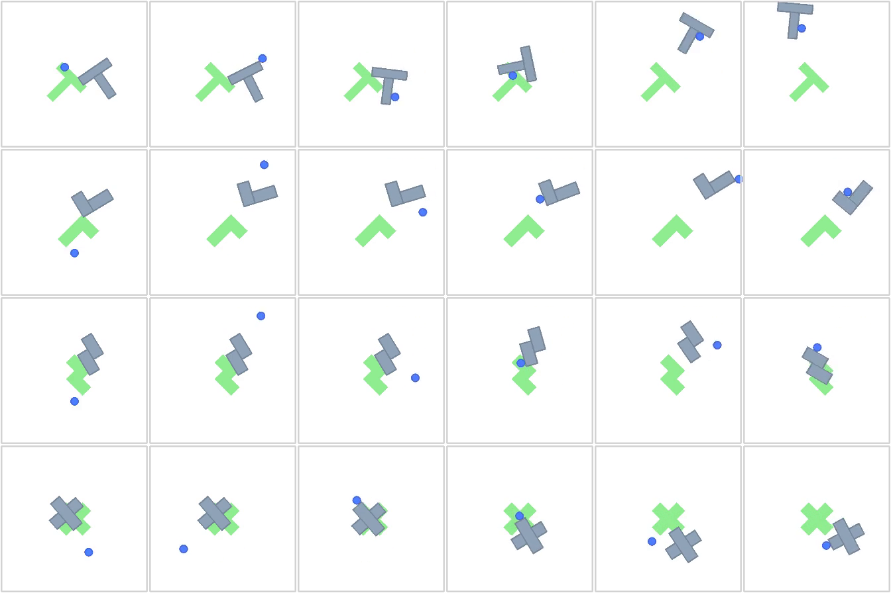
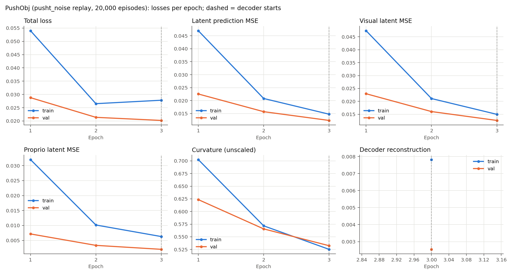
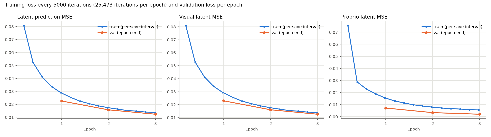
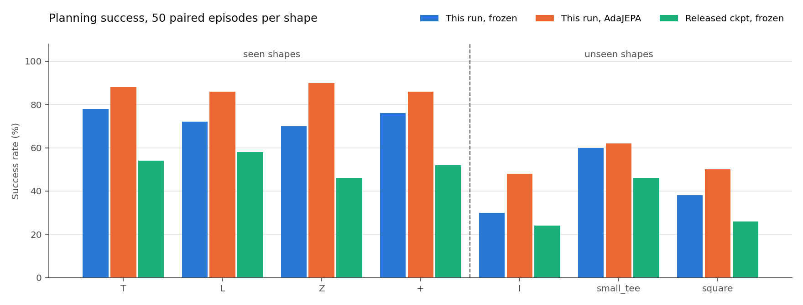

# PushObj 重新训练与评估报告（pusht_noise 回放数据 20,000 条，3 轮）

状态：训练与评估已全部完成。训练 3/3 轮，评估 14/14 组。生成时间（UTC）：2026-09-30T03:07:11。

## 主要结论

- 本次模型在 7 种形状、350 个目标上：冻结规划成功率 **60.6%**，AdaJEPA **72.9%**（+12.3 个百分点；配对后只有 AdaJEPA 成功 55 例、只有冻结成功 12 例，exact McNemar p=1.03e-07）。
- 已见形状 T/L/Z/+：冻结 74.0%，AdaJEPA 87.5%。
- 未见形状 I/small_tee/square：冻结 42.7%，AdaJEPA 53.3%。
- 同一批目标上，上一轮（原样回放 2 万条、5 轮）冻结 43.4% / AdaJEPA 48.0%；发布检查点冻结 43.7%。
- 验证潜在预测 MSE 逐轮下降，最后一轮最低（0.01234）。正式评估固定使用第 3 轮，没有按测试结果挑选检查点。
- 所有数字来自单个训练种子、每种形状 50 个目标；95% 区间约为 ±13 个百分点，单个形状之间的差异要谨慎解读。
- 与论文同协议（最多 20 次重规划）的超参数消融相比：T 上 AdaJEPA 提升 +10 个百分点（论文约 +31 到 +38），square 上 +12 个百分点（论文约 +15 到 +31）。冻结模型已接近发布检查点，但在线适应带来的提升明显小于论文。

## 训练数据

按 AdaJEPA 论文附录 A.2 的方法生成（脚本 `scripts/gen_pushobj_dataset.py`）：
从 DINO-WM 的 PushT 训练轨迹 `pusht_noise`（18,685 条带噪声的专家轨迹）出发，把 T 换成其他形状，从源轨迹的初始状态回放同一组动作。
- 源轨迹：前 16000 条作训练池，其余作为留出池（论文中用于测试），本次验证集取自留出池并只保留有接触的轨迹。
- 回放保真度：形状为 T 时生成的状态与源轨迹逐帧误差为 0.000 px，说明仿真环境与 DINO-WM 一致。
- 接触偏置（论文未给出公式，这是本仓库的实现）：把新形状的重心对齐到 T 在初始位姿下的重心；若仍无接触，在该位置加小幅随机扰动重试（最多 4 次，σ=20.0px / 0.3rad）。
- 边界处理：agent 是运动学刚体，会穿墙离开画面；剔除了 agent 任意时刻离开 [0,512] 的源轨迹（535 条，约 2.9%）。
- 规模：T/L/Z/+ 每种 4000 条训练 + 1000 条验证。论文 shape-shift 主实验为每种 4k 条、训练 3 轮；发布检查点配置为 5 轮。
- 质量门槛：初始状态要求 agent 与物体穿透不超过 3.0px、物体顶点全部在墙内，不合法时重新放置，仍不合法则换一条源轨迹；过程中推物体撞墙属于环境真实物理（作者评估数据中比例相近），予以保留，只剔除单步位移超过 80.0px 的数值爆炸。

| 数据检查 | 训练集 | 验证集 |
|---|---:|---:|
| 轨迹 / 帧 | 16000 / 1,934,266 | 4000 / 479,951 |
| 轨迹长度（最小/中位/最大） | 56 / 120 / 246 | 49 / 104 / 229 |
| 训练窗口数 | 1,630,266 | 403,951 |
| agent 出画面的帧 | 0 | 0 |
| 有接触的轨迹 | 100% | 100% |
| 物体首尾位移 >5px | 99.9% | 99.6% |
| agent 位置标准差 (px) | 108 / 108 | 110 / 111 |
| 不合法初始状态 | 0 | 0 |

对比上一轮随机游走数据：agent 出画面帧占 36.6%，位置标准差约 215px；仓库固定的归一化常数为 101/87px。新数据与这些常数基本吻合。



## 训练设置

架构和优化器与发布检查点 `pushobj_shape_shift/hydra.yaml` 相同，只改了数据和轮数。完整配置见 `training_config.yaml`。

| 项目 | 设置 |
|---|---|
| 编码器 | SmallResNetGeM，1×384 全局特征，从头训练 |
| 预测器 | ViT，6 层，16 heads，MLP 2048，dropout 0.1 |
| 时间 | frameskip=5，num_hist=3，num_pred=1 |
| 优化 | batch 64，3 轮，bf16；encoder lr 1e-05，predictor/action lr 0.0005，decoder lr 0.0003（第 3 轮起） |
| 正则 | 曲率 cos1e-2，stop_grad=True，VCReg 关闭 |
| 硬件 | 4 张 RTX 3090，每卡 batch 16（有效 batch 64），seed 0 |

总损失 = 潜在预测 MSE + 0.01×曲率 +（第 3 轮起）解码器重建损失；解码器输入停止梯度，只更新解码器本身。因此第 3 轮前后的总损失不可直接比较，看潜在预测 MSE 更合适。



| Epoch | Train total | Val total | Train latent | Val latent | Val visual | Val proprio | Val curvature | Val recon | 分钟 |
|---:|---:|---:|---:|---:|---:|---:|---:|---:|---:|
| 1 | 0.05400 | 0.02878 | 0.04697 | 0.02255 | 0.02295 | 0.00717 | 0.62350 | — | 58.3 |
| 2 | 0.02652 | 0.02137 | 0.02081 | 0.01572 | 0.01604 | 0.00335 | 0.56560 | — | 59.1 |
| 3 | 0.02782 | 0.02021 | 0.01475 | 0.01234 | 0.01260 | 0.00202 | 0.53238 | 0.00255 | 118.4 |

训练与逐轮验证合计 3.93 小时。

### 轮内训练曲线

每 5000 次迭代记录一次这段区间内的平均训练损失（`metrics_iter.jsonl`），并保存检查点 `model_e<轮>_it<迭代>.pth`；每轮 25,473 次迭代。



参考：本次最低验证潜在 MSE 为 0.01234（第 3 轮）；上一轮（原样回放 2 万条、5 轮）最低为 0.02166（第 5 轮）。两轮每轮迭代数和验证集都不同，只作量级参考。

## 规划评估

目标来自发布的 `data/pushobj_eval/val_<shape>/plan_targets.pkl`，每种形状 50 例，seed=100；冻结模型、AdaJEPA、发布检查点和上一轮都用完全相同的起点和目标。
- 规划：GD（Adam，lr 0.1，100 步），horizon 25 环境步，每次执行 5 步，最多 20 次重规划，staged 目标（alpha=1，base=2）。
- AdaJEPA：每次重规划后 1 步梯度更新（predictor lr 5e-4，encoder lr 1e-5），recent5 回放；只更新预测器最后一层及末端归一化，以及编码器 projection；每个样本开始前重置权重。
- 成功标准：agent 与物体位置的 4 维距离 <20px，且角度差 <π/9。区间为 Wilson 95% 置信区间。



| Shape | 类别 | 冻结 | AdaJEPA | 冻结 95% CI | AdaJEPA 95% CI | 仅 AdaJEPA 成功 / 仅冻结成功 | 发布检查点冻结 | 上一轮 冻结 / AdaJEPA |
|---|---|---:|---:|---|---|---:|---:|---:|
| T | 已见 | 39/50 | 44/50 | 65%–87% | 76%–94% | 6 / 1 | 54% | 27/50 / 28/50 |
| L | 已见 | 36/50 | 43/50 | 58%–83% | 74%–93% | 9 / 2 | 58% | 25/50 / 27/50 |
| Z | 已见 | 35/50 | 45/50 | 56%–81% | 79%–96% | 11 / 1 | 46% | 25/50 / 29/50 |
| + | 已见 | 38/50 | 43/50 | 63%–86% | 74%–93% | 7 / 2 | 52% | 33/50 / 31/50 |
| I | 未见 | 15/50 | 24/50 | 19%–44% | 35%–61% | 10 / 1 | 24% | 7/50 / 13/50 |
| small_tee | 未见 | 30/50 | 31/50 | 46%–72% | 48%–74% | 3 / 2 | 46% | 23/50 / 22/50 |
| square | 未见 | 19/50 | 25/50 | 26%–52% | 37%–63% | 9 / 3 | 26% | 12/50 / 18/50 |

| 汇总 | 本次冻结 | 本次 AdaJEPA | 差值 | McNemar p | 发布检查点冻结 | 上一轮 冻结 / AdaJEPA |
|---|---:|---:|---:|---:|---:|---:|
| 已见形状 | 74.0% | 87.5% | +13.5 pp | 1.43e-05 | 52.5% | 55.0% / 57.5% |
| 未见形状 | 42.7% | 53.3% | +10.7 pp | 0.00372 | 32.0% | 28.0% / 35.3% |
| 全部 | 60.6% | 72.9% | +12.3 pp | 1.03e-07 | 43.7% | 43.4% / 48.0% |

耗时：冻结每种形状平均 1.9 分钟（50 例一次批量规划），AdaJEPA 平均 34 分钟（逐例规划并适应）。

### 在线适应损失

每次更新前记录的 1 步潜在预测 MSE。第 1 次重规划与第 10 次及以后的对比可以看出适应是否在降低预测误差，但后期只剩尚未成功的样本，且回放缓冲区在变化，不能当作固定数据上的收敛曲线。

| Shape | 更新次数 | 平均 | 第 1 次重规划 | 第 10 次及以后 |
|---|---:|---:|---:|---:|
| T | 440 | 0.0207 | 0.0085 | 0.0386 |
| L | 431 | 0.0263 | 0.0114 | 0.0527 |
| Z | 427 | 0.0102 | 0.0160 | 0.0054 |
| + | 413 | 0.0144 | 0.0075 | 0.0234 |
| I | 758 | 0.0272 | 0.0442 | 0.0110 |
| small_tee | 585 | 0.0216 | 0.0210 | 0.0171 |
| square | 690 | 0.0289 | 0.0295 | 0.0215 |

## 与论文数字对照

本次评估最多 20 次重规划、每种形状 50 个目标、单个训练种子。论文数字来自不同的平均方式和协议（见最后一列），只能作为量级参考；冻结一侧可以用同一协议下的发布检查点做严格对照（见上表）。

| 指标 | 论文冻结 | 论文 AdaJEPA | 本次冻结 | 本次 AdaJEPA | 论文数字的条件 |
|---|---:|---:|---:|---:|---|
| 已见形状（数据规模实验 K=4, N=4k） | 51% | 81% | 74% | 88% | 3 个训练种子、多组训练形状平均；最多 20 次重规划 |
| 未见形状（数据规模实验 K=4, N=4k） | 36% | 52% | 43% | 53% | 同上 |
| T（超参数消融） | 50% | 81–88% | 78% | 88% | 最多 20 次重规划；AdaJEPA 为不同超参/回放设置的范围 |
| square（超参数消融） | 20% | 35–51% | 38% | 50% | 同上 |

## 局限

- 单个训练种子、每种形状 50 个目标，没有重复实验。
- 接触偏置的具体做法是本仓库的实现，论文没有给出细节。数据规模每种 4000 条，与论文主实验（每种 4k 条）相当。
- 发布的评估目标来自作者自己的测试集。它们不是 pusht_noise 的逐帧回放（动作序列无法精确匹配），所以无法严格排除本次训练源轨迹与作者测试集源轨迹之间的重叠。

## 建议的下一步

- 在 T 和 square 上用发布检查点跑同协议的 AdaJEPA（2 卡约 1 小时）：如果发布检查点的提升也远小于论文，差距来自评估协议或实现；如果它能达到论文幅度，问题在本次模型对在线适应的响应上。
- 多训练种子（至少 3 个）重复，才能对小于 ±13 个百分点的差异下结论。

## 文件与复现

- 数据：`data/pushobj_bias_16k`（审计 `dataset_audit.json`）；模型：`checkpoints/pushobj_bias_16k_e3_seed0`（第 3 轮 `checkpoints/model_3.pth`）；评估输出：`eval_outputs/pushobj_bias_16k_e3/<shape>/<frozen|adajepa>`。
- 本目录：`losses.csv`、`evaluation.csv`、`adaptation_losses.csv`、`training_config.yaml`、`pipeline_status.json`。

```bash
conda activate ts
python scripts/gen_pushobj_dataset.py --out-dir data/pushobj_bias_16k --train-per-shape 4000 --val-per-shape 1000 --n-workers 64
WANDB_MODE=offline SDL_VIDEODRIVER=dummy accelerate launch --multi_gpu --num_processes 4 --mixed_precision bf16 train.py --config-name train_pushobj_bias16k
python scripts/run_pushobj_evaluation.py --epochs 3 --model checkpoints/pushobj_bias_16k_e3_seed0 --data data/pushobj_bias_16k --report reports/pushobj_bias_16k --eval-dir eval_outputs/pushobj_bias_16k_e3 --gpus <ids>
```
