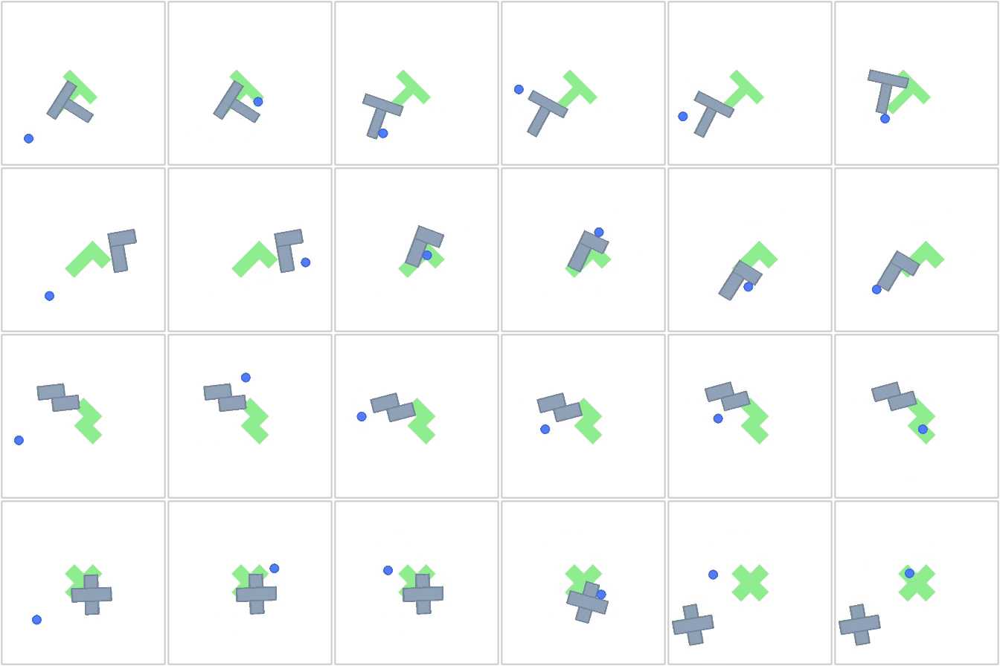
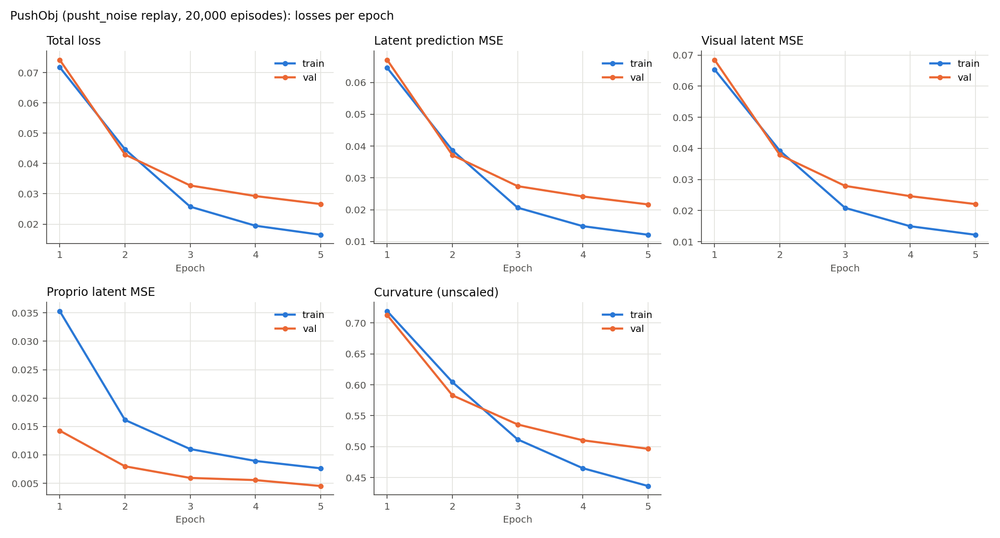
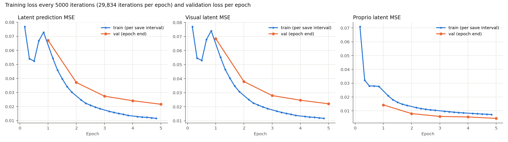
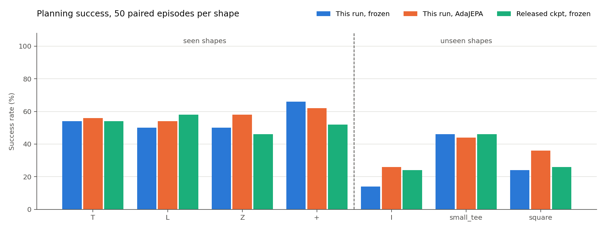

# PushObj 重新训练与评估报告（pusht_noise 回放数据 20,000 条，5 轮）

状态：训练与评估已全部完成。训练 5/5 轮，评估 14/14 组。生成时间（UTC）：2026-09-29T04:54:25。

## 主要结论

- 本次模型在 7 种形状、350 个目标上：冻结规划成功率 **43.4%**，AdaJEPA **48.0%**（+4.6 个百分点；配对后只有 AdaJEPA 成功 45 例、只有冻结成功 29 例，exact McNemar p=0.0805）。
- 已见形状 T/L/Z/+：冻结 55.0%，AdaJEPA 57.5%。
- 未见形状 I/small_tee/square：冻结 28.0%，AdaJEPA 35.3%。
- 同一批目标上，上一轮（2000 条回放数据、10 轮）冻结 18.9% / AdaJEPA 26.9%；发布检查点冻结 43.7%。
- 验证潜在预测 MSE 逐轮下降，最后一轮最低（0.02166）。正式评估固定使用第 5 轮，没有按测试结果挑选检查点。
- 所有数字来自单个训练种子、每种形状 50 个目标；95% 区间约为 ±13 个百分点，单个形状之间的差异要谨慎解读。
- 与论文同协议（最多 20 次重规划）的超参数消融相比：T 上 AdaJEPA 提升 +2 个百分点（论文约 +31 到 +38），square 上 +12 个百分点（论文约 +15 到 +31）。冻结模型已接近发布检查点，但在线适应带来的提升明显小于论文。

## 训练数据

按 AdaJEPA 论文附录 A.2 的方法生成（脚本 `scripts/gen_pushobj_dataset.py`）：
从 DINO-WM 的 PushT 训练轨迹 `pusht_noise`（18,685 条带噪声的专家轨迹）出发，把 T 换成其他形状，从源轨迹的初始状态回放同一组动作。
- 源轨迹：前 16000 条作训练池，其余作为留出池（论文中用于测试），本次验证集取自留出池并只保留有接触的轨迹。
- 回放保真度：形状为 T 时生成的状态与源轨迹逐帧误差为 0.000 px，说明仿真环境与 DINO-WM 一致。
- 接触偏置（论文未给出公式，这是本仓库的实现）：把新形状的重心对齐到 T 在初始位姿下的重心；若仍无接触，在该位置加小幅随机扰动重试（最多 4 次，σ=20.0px / 0.3rad）。
- 边界处理：agent 是运动学刚体，会穿墙离开画面；剔除了 agent 任意时刻离开 [0,512] 的源轨迹（535 条，约 2.9%）。
- 规模：T/L/Z/+ 每种 4500 条训练 + 500 条验证。论文 shape-shift 主实验为每种 4k 条、训练 3 轮；发布检查点配置为 5 轮。
- 质量门槛：初始状态要求 agent 与物体穿透不超过 3.0px、物体顶点全部在墙内，不合法时重新放置，仍不合法则换一条源轨迹；过程中推物体撞墙属于环境真实物理（作者评估数据中比例相近），予以保留，只剔除单步位移超过 80.0px 的数值爆炸。

| 数据检查 | 训练集 | 验证集 |
|---|---:|---:|
| 轨迹 / 帧 | 18000 / 2,251,362 | 2000 / 249,044 |
| 轨迹长度（最小/中位/最大） | 56 / 125 / 246 | 49 / 105 / 229 |
| 训练窗口数 | 1,909,362 | 211,044 |
| agent 出画面的帧 | 0 | 0 |
| 有接触的轨迹 | 100% | 100% |
| 物体首尾位移 >5px | 98.7% | 97.8% |
| agent 位置标准差 (px) | 103 / 97 | 103 / 100 |
| 不合法初始状态 | 0 | 0 |

对比上一轮随机游走数据：agent 出画面帧占 36.6%，位置标准差约 215px；仓库固定的归一化常数为 101/87px。新数据与这些常数基本吻合。



## 训练设置

架构和优化器与发布检查点 `pushobj_shape_shift/hydra.yaml` 相同，只改了数据和轮数，并关闭了 decoder（它只用于可视化，输入停止梯度，不影响世界模型；规划时需 decode_for_viz=false）。完整配置见 `training_config.yaml`。

| 项目 | 设置 |
|---|---|
| 编码器 | SmallResNetGeM，1×384 全局特征，从头训练 |
| 预测器 | ViT，6 层，16 heads，MLP 2048，dropout 0.1 |
| 时间 | frameskip=5，num_hist=3，num_pred=1 |
| 优化 | batch 64，5 轮，bf16；encoder lr 1e-05，predictor/action lr 0.0005，无 decoder |
| 正则 | 曲率 cos1e-2，stop_grad=True，VCReg 关闭 |
| 硬件 | 4 张 RTX 3090，每卡 batch 16（有效 batch 64），seed 0 |

总损失 = 潜在预测 MSE + 0.01×曲率。



| Epoch | Train total | Val total | Train latent | Val latent | Val visual | Val proprio | Val curvature | Val recon | 分钟 |
|---:|---:|---:|---:|---:|---:|---:|---:|---:|---:|
| 1 | 0.07177 | 0.07420 | 0.06458 | 0.06708 | 0.06845 | 0.01426 | 0.71261 | — | 61.9 |
| 2 | 0.04472 | 0.04298 | 0.03868 | 0.03715 | 0.03791 | 0.00798 | 0.58303 | — | 62.8 |
| 3 | 0.02576 | 0.03276 | 0.02065 | 0.02740 | 0.02796 | 0.00594 | 0.53596 | — | 62.9 |
| 4 | 0.01948 | 0.02927 | 0.01483 | 0.02416 | 0.02465 | 0.00556 | 0.51035 | — | 62.9 |
| 5 | 0.01649 | 0.02663 | 0.01213 | 0.02166 | 0.02211 | 0.00451 | 0.49659 | — | 62.9 |

训练与逐轮验证合计 5.22 小时。

### 轮内训练曲线

每 5000 次迭代记录一次这段区间内的平均训练损失（`metrics_iter.jsonl`），并保存检查点 `model_e<轮>_it<迭代>.pth`；每轮 29,834 次迭代。



训练集视觉潜在 MSE 在第 1 轮第 25,000 次迭代附近升到 0.0741，是此前最低值 0.0530 的 1.40 倍；之后在第 2 轮第 10,000 次迭代降回该最低值以下，此后没有再出现超过 20% 的回升。同一时刻 proprio 潜在 MSE 为其此前最低值的 0.99 倍，没有同步回升。这段区间内保存的检查点不宜使用。

参考：本次最低验证潜在 MSE 为 0.02166（第 5 轮）；上一轮（2000 条回放数据、10 轮）最低为 0.05377（第 4 轮）。两轮每轮迭代数和验证集都不同，只作量级参考。

## 规划评估

目标来自发布的 `data/pushobj_eval/val_<shape>/plan_targets.pkl`，每种形状 50 例，seed=100；冻结模型、AdaJEPA、发布检查点和上一轮都用完全相同的起点和目标。
- 规划：GD（Adam，lr 0.1，100 步），horizon 25 环境步，每次执行 5 步，最多 20 次重规划，staged 目标（alpha=1，base=2）。
- AdaJEPA：每次重规划后 1 步梯度更新（predictor lr 5e-4，encoder lr 1e-5），recent5 回放；只更新预测器最后一层及末端归一化，以及编码器 projection；每个样本开始前重置权重。
- 成功标准：agent 与物体位置的 4 维距离 <20px，且角度差 <π/9。区间为 Wilson 95% 置信区间。



| Shape | 类别 | 冻结 | AdaJEPA | 冻结 95% CI | AdaJEPA 95% CI | 仅 AdaJEPA 成功 / 仅冻结成功 | 发布检查点冻结 | 上一轮 冻结 / AdaJEPA |
|---|---|---:|---:|---|---|---:|---:|---:|
| T | 已见 | 27/50 | 28/50 | 40%–67% | 42%–69% | 5 / 4 | 54% | 16/50 / 21/50 |
| L | 已见 | 25/50 | 27/50 | 37%–63% | 40%–67% | 8 / 6 | 58% | 11/50 / 12/50 |
| Z | 已见 | 25/50 | 29/50 | 37%–63% | 44%–71% | 8 / 4 | 46% | 10/50 / 13/50 |
| + | 已见 | 33/50 | 31/50 | 52%–78% | 48%–74% | 4 / 6 | 52% | 15/50 / 18/50 |
| I | 未见 | 7/50 | 13/50 | 7%–26% | 16%–40% | 8 / 2 | 24% | 1/50 / 6/50 |
| small_tee | 未见 | 23/50 | 22/50 | 33%–60% | 31%–58% | 5 / 6 | 46% | 9/50 / 13/50 |
| square | 未见 | 12/50 | 18/50 | 14%–37% | 24%–50% | 7 / 1 | 26% | 4/50 / 11/50 |

| 汇总 | 本次冻结 | 本次 AdaJEPA | 差值 | McNemar p | 发布检查点冻结 | 上一轮 冻结 / AdaJEPA |
|---|---:|---:|---:|---:|---:|---:|
| 已见形状 | 55.0% | 57.5% | +2.5 pp | 0.551 | 52.5% | 26.0% / 32.0% |
| 未见形状 | 28.0% | 35.3% | +7.3 pp | 0.0614 | 32.0% | 9.3% / 20.0% |
| 全部 | 43.4% | 48.0% | +4.6 pp | 0.0805 | 43.7% | 18.9% / 26.9% |

耗时：冻结每种形状平均 2.3 分钟（50 例一次批量规划），AdaJEPA 平均 45 分钟（逐例规划并适应）。

### 在线适应损失

每次更新前记录的 1 步潜在预测 MSE。第 1 次重规划与第 10 次及以后的对比可以看出适应是否在降低预测误差，但后期只剩尚未成功的样本，且回放缓冲区在变化，不能当作固定数据上的收敛曲线。

| Shape | 更新次数 | 平均 | 第 1 次重规划 | 第 10 次及以后 |
|---|---:|---:|---:|---:|
| T | 626 | 0.0458 | 0.0416 | 0.0274 |
| L | 663 | 0.0549 | 0.0712 | 0.0221 |
| Z | 658 | 0.0552 | 0.0698 | 0.0235 |
| + | 626 | 0.0421 | 0.0447 | 0.0371 |
| I | 869 | 0.1203 | 0.2250 | 0.0474 |
| small_tee | 740 | 0.0638 | 0.0776 | 0.0290 |
| square | 789 | 0.0514 | 0.0815 | 0.0295 |

## 与论文数字对照

本次评估最多 20 次重规划、每种形状 50 个目标、单个训练种子。论文数字来自不同的平均方式和协议（见最后一列），只能作为量级参考；冻结一侧可以用同一协议下的发布检查点做严格对照（见上表）。

| 指标 | 论文冻结 | 论文 AdaJEPA | 本次冻结 | 本次 AdaJEPA | 论文数字的条件 |
|---|---:|---:|---:|---:|---|
| 已见形状（数据规模实验 K=4, N=4k） | 51% | 81% | 55% | 57% | 3 个训练种子、多组训练形状平均；最多 20 次重规划 |
| 未见形状（数据规模实验 K=4, N=4k） | 36% | 52% | 28% | 35% | 同上 |
| T（超参数消融） | 50% | 81–88% | 54% | 56% | 最多 20 次重规划；AdaJEPA 为不同超参/回放设置的范围 |
| square（超参数消融） | 20% | 35–51% | 24% | 36% | 同上 |

## 局限

- 单个训练种子、每种形状 50 个目标，没有重复实验。
- 接触偏置的具体做法是本仓库的实现，论文没有给出细节。数据规模每种 4500 条，与论文主实验（每种 4k 条）相当。
- 发布的评估目标来自作者自己的测试集。它们不是 pusht_noise 的逐帧回放（动作序列无法精确匹配），所以无法严格排除本次训练源轨迹与作者测试集源轨迹之间的重叠。

## 建议的下一步

- 在 T 和 square 上用发布检查点跑同协议的 AdaJEPA（2 卡约 1 小时）：如果发布检查点的提升也远小于论文，差距来自评估协议或实现；如果它能达到论文幅度，问题在本次模型对在线适应的响应上。
- 多训练种子（至少 3 个）重复，才能对小于 ±13 个百分点的差异下结论。

## 文件与复现

- 数据：`data/pushobj_replay_20k`（审计 `dataset_audit.json`）；模型：`checkpoints/pushobj_replay_20k_e5_seed0`（第 5 轮 `checkpoints/model_5.pth`）；评估输出：`eval_outputs/pushobj_replay_20k_e5/<shape>/<frozen|adajepa>`。
- 本目录：`losses.csv`、`evaluation.csv`、`adaptation_losses.csv`、`training_config.yaml`、`pipeline_status.json`。

```bash
conda activate ts
python scripts/gen_pushobj_dataset.py --out-dir data/pushobj_replay_20k --train-per-shape 4500 --val-per-shape 500 --n-workers 64
WANDB_MODE=offline SDL_VIDEODRIVER=dummy accelerate launch --multi_gpu --num_processes 4 --mixed_precision bf16 train.py --config-name train_pushobj_20k
python scripts/run_pushobj_evaluation.py --epochs 5 --model checkpoints/pushobj_replay_20k_e5_seed0 --data data/pushobj_replay_20k --report reports/pushobj_replay_20k_e5 --eval-dir eval_outputs/pushobj_replay_20k_e5 --gpus <ids>
```
