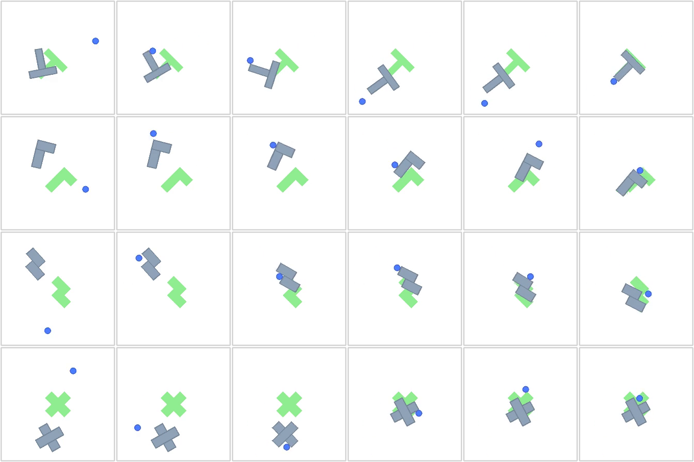
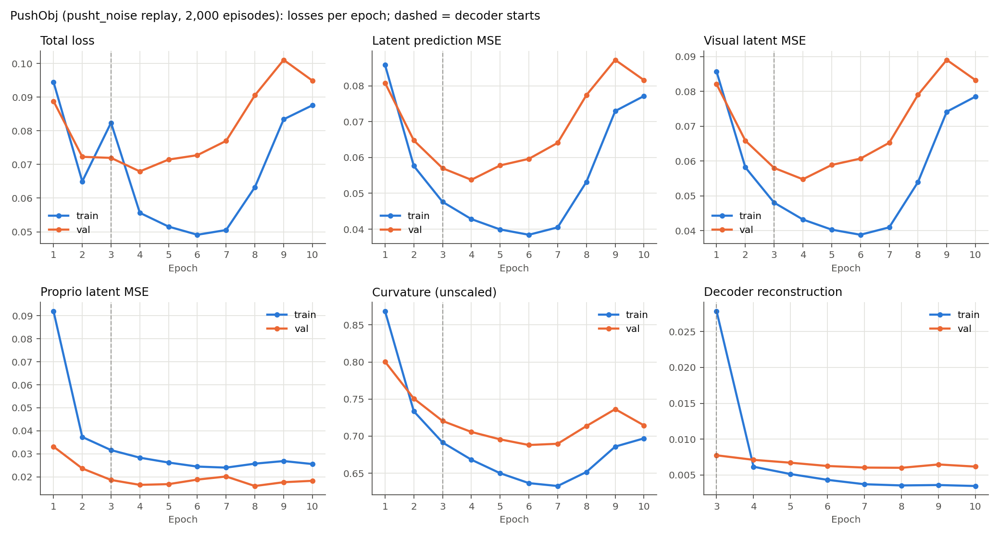
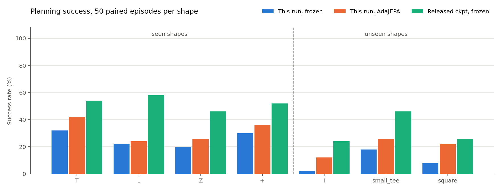

# PushObj 重新训练与评估报告（pusht_noise 回放数据，10 轮）

状态：训练与评估已全部完成。训练 10/10 轮，评估 14/14 组。生成时间（UTC）：2026-09-24T11:10:10。

## 主要结论

- 本次模型在 7 种形状、350 个目标上：冻结规划成功率 **18.9%**，AdaJEPA **26.9%**（+8.0 个百分点；配对后只有 AdaJEPA 成功 48 例、只有冻结成功 20 例，exact McNemar p=0.000914）。
- 已见形状 T/L/Z/+：冻结 26.0%，AdaJEPA 32.0%。
- 未见形状 I/small_tee/square：冻结 9.3%，AdaJEPA 20.0%。
- 同一批目标上，上一轮（随机游走数据、20 轮）冻结 4.0% / AdaJEPA 9.1%；发布检查点冻结 43.7%。
- 验证潜在预测 MSE 最低出现在第 4 轮（0.05377），第 10 轮为 0.08158。正式评估固定使用第 10 轮，没有按测试结果挑选检查点。
- 所有数字来自单个训练种子、每种形状 50 个目标；95% 区间约为 ±13 个百分点，单个形状之间的差异要谨慎解读。
- 训练后期不稳定：训练集视觉潜在 MSE 在第 6 轮最低（0.0388），到第 10 轮升到 0.0785（2.0 倍）。训练损失本身在涨，不是单纯过拟合；第 10 轮的成功率很可能低估了这份数据能达到的水平，详见“训练后期不稳定”。

## 训练数据

按 AdaJEPA 论文附录 A.2 的方法生成（脚本 `scripts/gen_pushobj_dataset.py`）：
从 DINO-WM 的 PushT 训练轨迹 `pusht_noise`（18,685 条带噪声的专家轨迹）出发，把 T 换成其他形状，从源轨迹的初始状态回放同一组动作。
- 源轨迹：前 16000 条作训练池，其余作为留出池（论文中用于测试），本次验证集取自留出池并只保留有接触的轨迹。
- 回放保真度：形状为 T 时生成的状态与源轨迹逐帧误差为 0.000 px，说明仿真环境与 DINO-WM 一致。
- 接触偏置（论文未给出公式，这是本仓库的实现）：把新形状的重心对齐到 T 在初始位姿下的重心；若仍无接触，在该位置加小幅随机扰动重试（最多 4 次，σ=20.0px / 0.3rad）。
- 边界处理：agent 是运动学刚体，会穿墙离开画面；剔除了 agent 任意时刻离开 [0,512] 的源轨迹（535 条，约 2.9%）。
- 规模：T/L/Z/+ 每种 450 条训练 + 50 条验证，与上一轮相同。论文主实验为每种 4k 条、训练 3 轮。

| 数据检查 | 训练集 | 验证集 |
|---|---:|---:|
| 轨迹 / 帧 | 1800 / 223,700 | 200 / 23,916 |
| 轨迹长度（最小/中位/最大） | 56 / 125 / 246 | 49 / 105 / 229 |
| 训练窗口数 | 189,500 | 20,116 |
| agent 出画面的帧 | 0 | 0 |
| 有接触的轨迹 | 100% | 100% |
| 物体首尾位移 >5px | 99.1% | 97.5% |
| agent 位置标准差 (px) | 103 / 96 | 102 / 99 |

对比上一轮随机游走数据：agent 出画面帧占 36.6%，位置标准差约 215px；仓库固定的归一化常数为 101/87px。新数据与这些常数基本吻合。



## 训练设置

架构和优化器与发布检查点 `pushobj_shape_shift/hydra.yaml` 相同，只改了数据和轮数。完整配置见 `training_config.yaml`。

| 项目 | 设置 |
|---|---|
| 编码器 | SmallResNetGeM，1×384 全局特征，从头训练 |
| 预测器 | ViT，6 层，16 heads，MLP 2048，dropout 0.1 |
| 时间 | frameskip=5，num_hist=3，num_pred=1 |
| 优化 | batch 64，10 轮，bf16；encoder lr 1e-05，predictor/action lr 0.0005，decoder lr 0.0003（第 3 轮起） |
| 正则 | 曲率 cos1e-2，stop_grad=True，VCReg 关闭 |
| 硬件 | 单卡 RTX 3090（GPU 4），seed 0 |

总损失 = 潜在预测 MSE + 0.01×曲率 +（第 3 轮起）解码器重建损失；解码器输入停止梯度，只更新解码器本身。因此第 3 轮前后的总损失不可直接比较，看潜在预测 MSE 更合适。



| Epoch | Train total | Val total | Train latent | Val latent | Val visual | Val proprio | Val curvature | Val recon | 分钟 |
|---:|---:|---:|---:|---:|---:|---:|---:|---:|---:|
| 1 | 0.09451 | 0.08881 | 0.08582 | 0.08081 | 0.08205 | 0.03316 | 0.80043 | — | 12.7 |
| 2 | 0.06497 | 0.07227 | 0.05764 | 0.06476 | 0.06584 | 0.02365 | 0.75072 | — | 12.0 |
| 3 | 0.08239 | 0.07195 | 0.04762 | 0.05700 | 0.05800 | 0.01866 | 0.72048 | 0.00774 | 41.0 |
| 4 | 0.05564 | 0.06794 | 0.04281 | 0.05377 | 0.05474 | 0.01653 | 0.70567 | 0.00711 | 41.0 |
| 5 | 0.05154 | 0.07146 | 0.03992 | 0.05779 | 0.05886 | 0.01685 | 0.69566 | 0.00671 | 41.1 |
| 6 | 0.04912 | 0.07276 | 0.03844 | 0.05963 | 0.06069 | 0.01882 | 0.68804 | 0.00625 | 41.0 |
| 7 | 0.05053 | 0.07701 | 0.04050 | 0.06409 | 0.06523 | 0.02017 | 0.68974 | 0.00603 | 40.9 |
| 8 | 0.06326 | 0.09055 | 0.05321 | 0.07741 | 0.07901 | 0.01604 | 0.71366 | 0.00600 | 40.8 |
| 9 | 0.08341 | 0.10106 | 0.07296 | 0.08723 | 0.08905 | 0.01768 | 0.73646 | 0.00646 | 40.8 |
| 10 | 0.08758 | 0.09489 | 0.07716 | 0.08158 | 0.08323 | 0.01829 | 0.71451 | 0.00616 | 40.8 |

训练与逐轮验证合计 5.87 小时。

### 训练后期不稳定

训练集视觉潜在 MSE 在第 6 轮后开始回升，到第 10 轮达到最低值的 2.0 倍；proprio 潜在 MSE 和解码器重建损失没有同步变差。训练损失本身上升，说明问题出在优化而不是过拟合。

为排除“特征尺度变大导致 MSE 变大”，检查了各轮编码器在 96 帧验证图像上的输出方差（`latent_scale_diagnostic.json`）：

| Epoch | 2 | 4 | 6 | 8 | 10 |
|---|---:|---:|---:|---:|---:|
| 样本间方差（384 维平均） | 0.835 | 0.868 | 0.914 | 0.892 | 0.966 |

同样从第 6 轮到第 10 轮，训练视觉潜在 MSE 变为 2.0 倍，而编码器输出方差只变化 +6%，所以不是特征尺度变大造成的，预测本身确实变差了。

可能原因是恒定学习率（predictor 5e-4）、无学习率调度、无梯度裁剪下的优化不稳定；这只是推测，本次没有做对照实验。发布配置只训 5 轮、论文训 3 轮，或许与此有关。

参考：上一轮在第 10 轮的验证潜在 MSE 为 0.04684。两轮的验证集不同（数据分布不同），这个数字只作量级参考。

## 规划评估

目标来自发布的 `data/pushobj_eval/val_<shape>/plan_targets.pkl`，每种形状 50 例，seed=100；冻结模型、AdaJEPA、发布检查点和上一轮都用完全相同的起点和目标。
- 规划：GD（Adam，lr 0.1，100 步），horizon 25 环境步，每次执行 5 步，最多 20 次重规划，staged 目标（alpha=1，base=2）。
- AdaJEPA：每次重规划后 1 步梯度更新（predictor lr 5e-4，encoder lr 1e-5），recent5 回放；只更新预测器最后一层及末端归一化，以及编码器 projection；每个样本开始前重置权重。
- 成功标准：agent 与物体位置的 4 维距离 <20px，且角度差 <π/9。区间为 Wilson 95% 置信区间。



| Shape | 类别 | 冻结 | AdaJEPA | 冻结 95% CI | AdaJEPA 95% CI | 仅 AdaJEPA 成功 / 仅冻结成功 | 发布检查点冻结 | 上一轮 冻结 / AdaJEPA |
|---|---|---:|---:|---|---|---:|---:|---:|
| T | 已见 | 16/50 | 21/50 | 21%–46% | 29%–56% | 9 / 4 | 54% | 6/50 / 6/50 |
| L | 已见 | 11/50 | 12/50 | 13%–35% | 14%–37% | 4 / 3 | 58% | 3/50 / 6/50 |
| Z | 已见 | 10/50 | 13/50 | 11%–33% | 16%–40% | 7 / 4 | 46% | 0/50 / 3/50 |
| + | 已见 | 15/50 | 18/50 | 19%–44% | 24%–50% | 8 / 5 | 52% | 1/50 / 5/50 |
| I | 未见 | 1/50 | 6/50 | 0%–10% | 6%–24% | 5 / 0 | 24% | 1/50 / 2/50 |
| small_tee | 未见 | 9/50 | 13/50 | 10%–31% | 16%–40% | 7 / 3 | 46% | 3/50 / 7/50 |
| square | 未见 | 4/50 | 11/50 | 3%–19% | 13%–35% | 8 / 1 | 26% | 0/50 / 3/50 |

| 汇总 | 本次冻结 | 本次 AdaJEPA | 差值 | McNemar p | 发布检查点冻结 | 上一轮 冻结 / AdaJEPA |
|---|---:|---:|---:|---:|---:|---:|
| 已见形状 | 26.0% | 32.0% | +6.0 pp | 0.0961 | 52.5% | 5.0% / 10.0% |
| 未见形状 | 9.3% | 20.0% | +10.7 pp | 0.00154 | 32.0% | 2.7% / 8.0% |
| 全部 | 18.9% | 26.9% | +8.0 pp | 0.000914 | 43.7% | 4.0% / 9.1% |

耗时：冻结每种形状平均 1.9 分钟（50 例一次批量规划），AdaJEPA 平均 55 分钟（逐例规划并适应）。

### 在线适应损失

每次更新前记录的 1 步潜在预测 MSE。第 1 次重规划与第 10 次及以后的对比可以看出适应是否在降低预测误差，但后期只剩尚未成功的样本，且回放缓冲区在变化，不能当作固定数据上的收敛曲线。

| Shape | 更新次数 | 平均 | 第 1 次重规划 | 第 10 次及以后 |
|---|---:|---:|---:|---:|
| T | 739 | 0.1341 | 0.1820 | 0.0820 |
| L | 861 | 0.1312 | 0.1618 | 0.0846 |
| Z | 884 | 0.1215 | 0.1692 | 0.0639 |
| + | 849 | 0.1182 | 0.1524 | 0.0709 |
| I | 945 | 0.1608 | 0.2567 | 0.0937 |
| small_tee | 878 | 0.1244 | 0.1937 | 0.0745 |
| square | 915 | 0.1226 | 0.2467 | 0.0610 |

## 局限

- 单个训练种子、每种形状 50 个目标，没有重复实验。
- 接触偏置的具体做法是本仓库的实现，论文没有给出细节；数据规模（每种 450 条）比论文主实验（每种 4k 条）小约 9 倍。
- 发布的评估目标来自作者自己的测试集。它们不是 pusht_noise 的逐帧回放（动作序列无法精确匹配），所以无法严格排除本次训练源轨迹与作者测试集源轨迹之间的重叠。
- 正式评估固定用第 10 轮；若训练后期不稳定，这个检查点不是本次训练中最好的模型。

## 建议的下一步

- 先用已有检查点补充冻结评估（如验证损失最低的一轮和训练损失最低的一轮），3 张卡每个检查点约 5 分钟，确认早期检查点是否规划得更好。
- 训练稳定性：加学习率衰减或梯度裁剪，或者按验证损失早停后再评估。
- 数据规模：论文主实验每种形状 4k 条，本次 450 条；数据量是与发布检查点差距的另一个候选原因。
- 训练可用 2 卡（有效 batch 保持 64，BN 统计量按每卡 32 计算），预计把约 6 小时缩短到约 3.5 小时。

## 文件与复现

- 数据：`data/pushobj_replay_2000`（审计 `dataset_audit.json`）；模型：`checkpoints/pushobj_replay_2000_e10_seed0`（第 10 轮 `checkpoints/model_10.pth`）；评估输出：`eval_outputs/pushobj_replay_e10/<shape>/<frozen|adajepa>`。
- 本目录：`losses.csv`、`evaluation.csv`、`adaptation_losses.csv`、`training_config.yaml`、`pipeline_status.json`。

```bash
conda activate ts
python scripts/gen_pushobj_dataset.py --out-dir data/pushobj_replay_2000 --n-workers 48
CUDA_VISIBLE_DEVICES=4 WANDB_MODE=offline SDL_VIDEODRIVER=dummy python train.py --config-name train_pushobj
python scripts/run_pushobj_evaluation.py --epochs 10 --gpus 4,5,7
```
